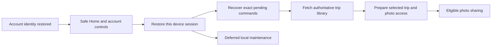

# Startup readiness and protected-state restoration

Status: implemented and locally verified as one candidate. This supersedes
treating Android build16 / iOS build25 as the final startup repair. Publication
remains held for full native SDK compilation and installed-device acceptance.

## Problem and evidence

The affected Samsung trace showed two consecutive native cleanup operations of
about ten seconds each, then repeated identity/session/snapshot operations. A
retry reached successful trip API responses and then spent another 16.8 seconds
in key import. The unchanged thirty-second bootstrap deadline could expire
before a usable account screen appeared. Individual hardware cipher operations
were not timed, and no heap profile established or excluded a memory leak.

The first repairs reduced duplicated work, but their three-load restored-trip
model was not a physical speed result. Each Android load still reconstructed
every protected secret in the database. Separately, the JavaScript coordinator
made Home depend on device setup, durable-command recovery, trip listing,
hydration and native photo activation. A failure late in that sequence could
discard an already restored device session and repeat it on Retry.

iOS is not an architectural counterexample. It also reads the logical database
as a whole, but through one Keychain item followed by JSON decoding. Android
additionally opened each stored secret using the Keystore key. Android requests
StrongBox when supported; the affected phone's actual security level and
per-operation hardware latency were not independently captured.

## Decision

Separate app, device, trip and photo readiness. Keep one owner of the account's
startup attempt and publish typed capabilities rather than interpreting a phase
name as permission to perform every operation.

The diagram describes readiness, not a reason to delay rendering B until G.
Durable recovery and server authorization remain authoritative. An early
display-only library result must never retire or activate a trip after a command
replay; reconciliation requires a fresh result after that replay.

| Boundary                   | Usable behavior                                                 | Authority still required                                                   |
| -------------------------- | --------------------------------------------------------------- | -------------------------------------------------------------------------- |
| Account restoration        | Neutral, responsive initial screen with honest recovery         | No prior-account data before identity is established                       |
| Authenticated shell        | Stable Home structure, account controls and current work status | Canonical profile and accepted terms for registration and mutations        |
| Device restored            | Account/device-scoped library reads                             | Pending commands reconciled before new mutations                           |
| Trips loaded               | Real authorized trip information and inline refresh/retry       | Current membership, native key and permissions before sharing              |
| Photo preparation complete | Eligible capture and transfer controls                          | Existing expiry, revocation, consent and lifecycle rules continue to apply |
| Teardown                   | Explicit signing-out state and safe retry                       | Old account data and actions remain unavailable                            |

Photo-library permission is a sharing requirement. It must not globally expel a
signed-in user from the trip library. Profile and terms requirements still apply
to the operations the backend protects.

## Protected storage

Choose selective decoding of the existing Android format. The outer AES-GCM
record continues to authenticate the full container. Bounded metadata is parsed
without opening unrelated inner secret records. A stored secret is either an
owned new value or an opaque ciphertext reference bound to its canonical account,
installation, record type and version AAD. Materialize only the identity,
credential and selected key an operation actually needs.

Saving preserves unchanged bound ciphertext and seals changed secret values.
The existing immediate saves and atomic replacement remain; this is not a
write-behind cache. Account erasure and retention can remove opaque records
without decrypting unrelated keys. Owned plaintext is cleared at the synchronous
command boundary. Only the existing, deliberately selected native media lease
may survive that boundary, subject to its account, policy and expiry fences.

Device preparation returns public identity, a valid restored device identifier
and an optional public selection hint. It must not open the trip key. A corrupt
trip key is a trip/photo preparation failure, not a reason to discard a valid
device session or make the library inaccessible.

| Alternative                                          | Tradeoff                                                                   | Decision                                                  |
| ---------------------------------------------------- | -------------------------------------------------------------------------- | --------------------------------------------------------- |
| Change loading text only                             | Leaves real storage work and retries unchanged                             | Insufficient                                              |
| Cache the entire decrypted database                  | Widens plaintext lifetime and invalidation requirements                    | Rejected                                                  |
| Selective access in the current authenticated format | More internal storage representation code; retains format and protection   | Selected                                                  |
| Hardware-wrapped data key with software AEAD         | Bounds hardware operations but needs format migration and downgrade review | Deferred unless measured selected-record costs require it |

The number of file loads is not the number of protected cipher operations.
Verification must count opens, seals, P-256 provider lookups and records actually
materialized separately. The isolated native tests populate a fake store with up
to 768 unrelated keys to check this property. They do not add those keys to a
phone, live account or hosted database, and do not describe the affected phone's
actual key count. Those extra fixtures must not cause their secrets to be opened
during restoration of the selected session.

## Native lifecycle and maintenance

Interactive preparation must not synchronously force global cleanup. Production
lifecycles request a coalesced utility task after interactive command ownership
ends. Admission to that task cannot wait on the lock held by a running cleanup.
Its deadline timer and the platform's background entry points remain independent
of React mounting or network availability.

The transfer engine is not constructed just to acknowledge an initial pause.
Local retention may construct a paused engine on the maintenance lane to drain
expired local files safely; doing so must not start photo discovery or network
transfer. An existing engine still drains in-flight verified saves before a
teardown acknowledgment. Cold foreground entry does not activate an unprepared
selection; explicit platform background jobs retain their existing authority.
On iOS, one process-wide visibility source supplies versioned snapshots. The
engine actor rejects stale deliveries, so an older foreground task cannot
overwrite a newer background transition, including after lazy engine creation.

Deferring physical cleanup does not extend validity. Check the current credential
and selected-key deadlines at access, including after slow validation. Reject
expired create/wrap/use operations. A fresh authenticated import of an expired
provisional key follows the existing selected-record purge/recovery semantics,
with its original durable boundaries. Physical deletion still depends on an
available process/OS execution window; access expiry must not depend on it.

## Progress, failure and retry

Progress is a projection of work that is actually running:

- Restoring your account.
- Restoring this phone.
- Checking your last trip request.
- Getting your trips ready.
- Preparing photo sharing.

Do not invent percentages or diagnose a network failure because a timer elapsed.
Keep the Home layout stable while these states change. An actionable trip-list
or photo-preparation failure is inline; it does not automatically erase valid
device readiness. Retry resumes the failed stage. Accepted/uncertain mutations
retain their exact durable command identities and recovery order.

Account replacement, credential replacement and sign-out invalidate old work
before awaiting anything. A late result cannot publish old data, enable an old
action, or clear the next account's context. UI button state and action methods
both enforce the typed capabilities.

## Verification and publication

The candidate is one combined change across startup orchestration, native
storage/lifecycle and user-visible readiness. No intermediate store upload or
deployment is part of this work.

Required automated evidence:

1. The authenticated shell renders while controlled device/trip work is held
   unresolved; account controls remain usable and mutations/sharing stay gated.
2. Trip and photo retries preserve a valid device and successful prior outcomes.
3. Pending JOIN/CREATE/START/readiness replay precedes the fresh authoritative
   library used for retirement or activation.
4. Account changes, logout and late completions are tested at each readiness
   boundary. No prior-account content or authority survives.
5. Unrelated retained records do not increase secret opens during selected
   restoration; unchanged saves do not reseal them.
6. Existing format fixtures, AAD tampering, locked/lost storage, immediate
   persistence and atomic failures remain covered.
7. Deferred maintenance is coalesced, does not block request admission, preserves
   OS entry points, and cannot permit expired credential/key use.
8. Permission denial/limited access/settings recovery affects sharing rather than
   the entire app's navigation. Push and preview failures remain separate.

Local validation on November 15 passed the full quality command (format, lint,
types, migration policy, production resolution, 1,454 tooling tests, 1,109 app
tests, 866 contract/service units and 21 Expo Doctor checks). The Android app
preset also passed 1,109 tests. Each app preset skips one check belonging to the
other operating system. Native suites passed 153 Android JVM tests and 122 Swift
tests, including expiry, sealed-record tampering, failed saves, selection scope,
deferred cleanup and out-of-order visibility. These are not native SDK build or
phone timing results.

Physical evidence remains required: cold, warm and resumed release-build timing
on the affected Samsung and a representative iPhone. Record first frame, first
usable shell, authoritative trip information and actual sharing readiness
separately. A quick splash is not a usable app. Repeated startup/retry/logout
cycles also require heap/retained-object observation; zeroization and counters do
not establish absence of a memory leak. Existing original-photo integrity and
permission-recovery acceptance remain separate release gates.

## Primary references

- [Android startup analysis](https://developer.android.com/topic/performance/appstartup/analysis-optimization): identify necessary critical-path work, defer other initialization, measure initial display and fully useful display separately.
- [Android startup remedies](https://developer.android.com/topic/performance/issues/launch-time): lazy initialization and avoiding blocking display on storage/network work.
- [Android Keystore](https://developer.android.com/privacy-and-security/keystore): hardware-key protection and StrongBox resource/performance tradeoffs.
- [Android offline-first data layer](https://developer.android.com/topic/architecture/data-layer/offline-first): observable local reads and distinct synchronization failures.
- [Apple launch guidance](https://developer.apple.com/documentation/xcode/reducing-your-app-s-launch-time.md): prepare the first useful UI and initialize nonview functionality when needed.
- [Expo SDK57 splash guidance](https://docs.expo.dev/versions/v57.0.0/sdk/splash-screen/): show renderable content before hiding the native splash and verify release-build behavior.
- [Tink key-management design](https://developers.google.com/tink/key-management-overview): a protected key-encryption key can wrap data keys; library fallback behavior and migration must still be reviewed before adoption.
